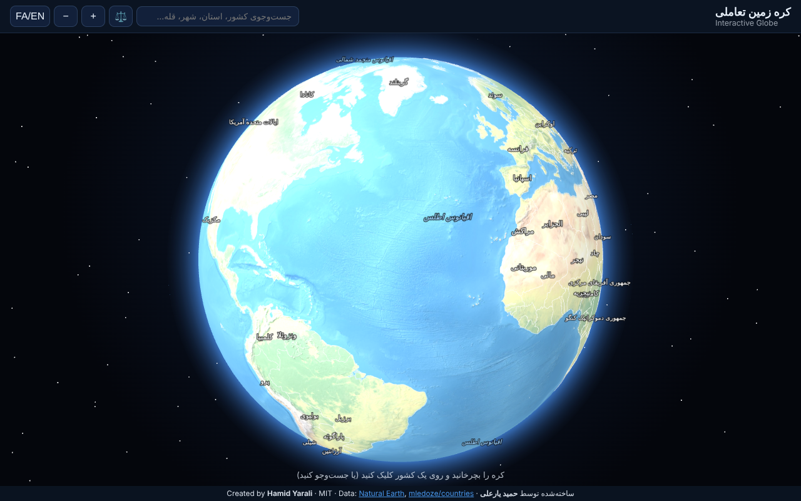
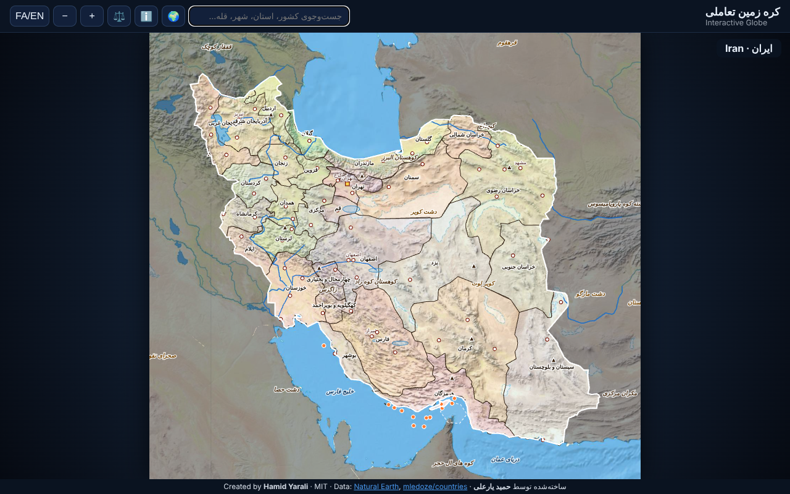
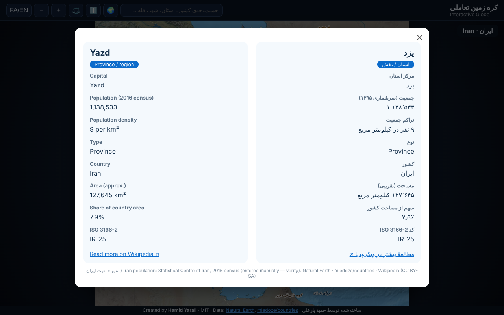
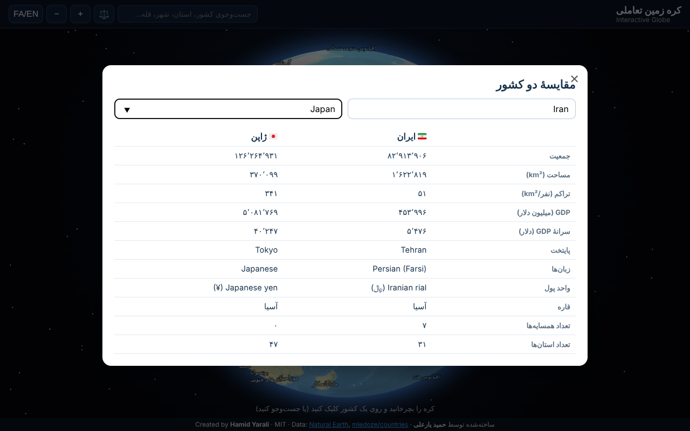

<div align="center">

# 🌍 کره زمین تعاملی · Interactive Globe

**[فارسی](#فارسی) · [English](#english)**



</div>

---

## فارسی

کرهٔ زمین سه‌بعدی (Three.js) که با کشیدن موس یا انگشت می‌چرخد. روی هر کشور کلیک کنید یا **کشور، استان، شهر و قله** را جست‌وجو کنید تا به **نقشهٔ ناهمواری** آن کشور با استان‌ها، رودها، دریاچه‌ها، دریاها، جزایر، رشته‌کوه‌ها، کویرها، شهرها و قله‌ها برسید. روی هر چیز کلیک کنید تا مشخصات آن به‌صورت **دوزبانهٔ فارسی و انگلیسی** در یک مودال نمایش داده شود.





### ویژگی‌ها
- **کره:** تصویر ناهمواری، جو، ستاره‌ها، نام کشورها و اقیانوس‌ها روی کره (بسته به زوم)، برجسته‌شدن کشور زیر موس، زوم با چرخ ماوس یا دو انگشت
- **اطلاعات کشورها (۲۴۱ کشور):** پرچم، نام رسمی، قاره، پایتخت، جمعیت، مساحت، تراکم، GDP و سرانه، گروه درآمدی، زبان‌ها، واحد پول، پیش‌شماره تلفن، دامنه اینترنتی، عنوان شهروندان، منطقهٔ زمانی، **کشورهای همسایه** و تعداد استان‌ها
- **داخل هر کشور:** ۴٬۵۹۶ استان / ایالت با نام فارسی، رودها، دریاچه‌ها، دریاها و خلیج‌ها، جزایر، رشته‌کوه‌ها، کویرها و فلات‌ها، شهرها (نام فارسی) و قله‌ها
- **ایران:** مرکز و جمعیت استان‌ها، تنگهٔ هرمز، جزایر و توضیحات دریاها و رشته‌کوه‌ها، کارون، زاینده‌رود و دز، دریاچه‌های شور
- **خلاصهٔ ویکی‌پدیا** داخل مودال (فارسی و انگلیسی؛ روی سرور http یا GitHub Pages)
- **جست‌وجو** در کشور، استان، شهر و قله؛ **لینک مستقیم** هر کشور (`#IRN`)؛ **مقایسهٔ دو کشور**؛ تغییر **زبان کل رابط** (FA/EN)
- **نقشهٔ ناهمواری با وضوح بالا** (۶۰ پیکسل در درجه، کاشی‌های بارگذاری در لحظه) برای کشورهای متوسط و کوچک
- بارگذاری تنبل داده هر کشور، **PWA** (نصب و کار آفلاین) و **GitHub Actions** برای انتشار خودکار

### اجرا
```bash
git clone https://github.com/<your-username>/interactive-globe.git
cd interactive-globe
# index.html را باز کنید (بدون کاشی‌های پرجزئیات)، یا برای همهٔ امکانات:
python3 -m http.server 8000   # سپس http://localhost:8000
```
انتشار روی **GitHub Pages**: Settings ← Pages ← Source: GitHub Actions (فایل `.github/workflows/pages.yml` آماده است).

### ساختار پروژه
| مسیر | توضیح |
|---|---|
| `index.html`, `style.css`, `app.js` | رابط کاربری، کرهٔ سه‌بعدی و نقشهٔ کشورها |
| `vendor/three.min.js` | Three.js r128 (MIT) |
| `data/world.js` | کشورها، دریاها، عوارض جغرافیایی و نمایهٔ جست‌وجو (تولیدشده) |
| `data/c/<A3>.js` | داده هر کشور: استان‌ها، رودها، دریاچه‌ها، شهرها، قله‌ها (بارگذاری در لحظه) |
| `data/earth.jpg`, `data/earth.js` | بافت جهانی (فایل JPEG؛ نسخهٔ `.js` برای اجرای مستقیم از `file://`) |
| `data/tiles/` | ۳۲ کاشی ناهمواری با وضوح بالا |
| `data/info.js` | اطلاعات دستی ایران |
| `tools/` | `fetch_sources.sh`, `build_data.py`, `make_tiles.py`, `fetch_wikidata_population.py` |
| `sw.js`, `manifest.webmanifest`, `icon-*.png` | PWA |

### نکته‌ها
- داده‌ها از [Natural Earth](https://www.naturalearthdata.com/) (دامنهٔ عمومی) و [mledoze/countries](https://github.com/mledoze/countries) (ODbL) است. مرزها ساده‌سازی شده، مساحت‌ها **تقریبی** و جمعیت و GDP **تخمینی**‌اند؛ مرزها و نام‌ها از Natural Earth پیروی می‌کنند و دیدگاه سیاسی ندارند.
- جمعیت استان‌های **ایران** و توضیحات جزایر، رودها و دریاچه‌های ایران را نویسنده دستی وارد کرده است؛ پیش از انتشار عمومی با منبع رسمی (مرکز آمار ایران) تطبیق دهید.
- جمعیت استان‌های دیگر کشورها در داده‌های Natural Earth نیست. اسکریپت `tools/fetch_wikidata_population.py` برای پر کردن آن از ویکی‌داده نوشته شده، اما **آزمایش نشده** است.
- نام فارسی از Natural Earth آمده؛ نام زبان‌ها و واحد پول فقط انگلیسی است.

---

## English

A 3D globe (Three.js) you spin with the mouse or a finger. Click a country, or search **countries, provinces, cities and peaks**, to open its **relief map** with provinces, rivers, lakes, seas, islands, mountain ranges, deserts, cities and peaks. Click anything for a **bilingual (Persian / English)** modal.

### Features
- **Globe:** relief texture, atmosphere, stars, country and ocean labels (zoom-dependent), hover highlight, wheel / pinch zoom
- **Country facts (241 countries):** flag, official name, continent, capital, population, area, density, GDP and per-capita, income group, languages, currency, calling code, internet domain, demonym, timezone, **neighbours**, number of divisions
- **Inside each country:** 4,596 provinces / states (Persian names), rivers, lakes, seas and gulfs, islands, mountain ranges, deserts and plateaus, cities (Persian names), peaks
- **Iran:** province capitals and populations, Strait of Hormuz, islands, notes on seas and ranges, Karun / Zayandeh / Dez, salt lakes
- **Wikipedia summaries** in the modal (Persian and English; on an http server or GitHub Pages)
- **Search** countries, provinces, cities and peaks; **deep links** (`#IRN`); **compare two countries**; full **UI language** switch (FA/EN)
- **High-resolution relief** (60 px/degree, tiles loaded on demand) for small and mid-size countries
- Lazy per-country data, **PWA** (installable, offline) and a **GitHub Actions** deploy workflow

### Run
```bash
git clone https://github.com/<your-username>/interactive-globe.git
cd interactive-globe
# open index.html (without the high-res tiles), or for every feature:
python3 -m http.server 8000   # then visit http://localhost:8000
```
Deploy on **GitHub Pages**: Settings → Pages → Source: GitHub Actions (`.github/workflows/pages.yml` is included).

### Project structure
| Path | Description |
|---|---|
| `index.html`, `style.css`, `app.js` | UI, 3D globe and country maps |
| `vendor/three.min.js` | Three.js r128 (MIT) |
| `data/world.js` | Countries, water bodies, regions and the search index (generated) |
| `data/c/<A3>.js` | Per-country data: provinces, rivers, lakes, cities, peaks (lazy-loaded) |
| `data/earth.jpg`, `data/earth.js` | Global texture (JPEG; the `.js` copy lets it run from `file://`) |
| `data/tiles/` | 32 high-resolution relief tiles |
| `data/info.js` | Hand-written Iran data |
| `tools/` | `fetch_sources.sh`, `build_data.py`, `make_tiles.py`, `fetch_wikidata_population.py` |
| `sw.js`, `manifest.webmanifest`, `icon-*.png` | PWA |

### Notes
- Data: [Natural Earth](https://www.naturalearthdata.com/) (public domain) and [mledoze/countries](https://github.com/mledoze/countries) (ODbL). Borders are simplified, areas **approximate**, population and GDP **estimates**; boundaries and names follow Natural Earth and take no political position.
- Iran’s province populations and the notes on its islands, rivers and lakes were entered by hand; verify against an official source (Statistical Centre of Iran) before public release.
- Province populations for other countries are not in Natural Earth. `tools/fetch_wikidata_population.py` is meant to fill them from Wikidata but is **untested**.
- Persian names come from Natural Earth; language and currency names are English only.

---

## 👤 Author · سازنده
**حمید یارعلی · Hamid Yarali**

## 📄 License · مجوز
[MIT](LICENSE) © 2026 Hamid Yarali · Three.js © its authors (MIT)
